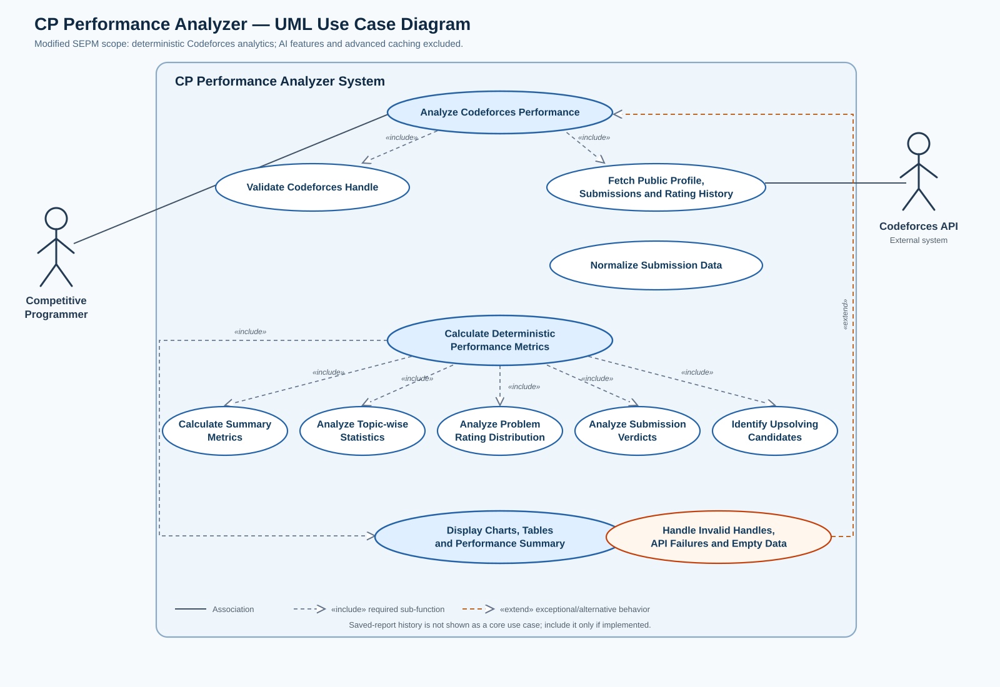

# CP Performance Analyzer — User Stories and Use Case Diagram

## Project scope

The current SEPM increment focuses on deterministic analysis of public Codeforces data: summary statistics, topic-wise results, problem-rating distribution, submission verdicts, and upsolving candidates. AI Coach, AI-generated practice plans, advanced caching, and background workers are outside this increment. Authentication and saved-report history are conditional on the current implementation.

## Actors

- **Competitive Programmer:** primary actor who enters a handle and reviews the analytics.
- **Codeforces API:** external source of public profile, submissions, and contest-rating history.
- **Returning User:** may open a saved report if report history is implemented.

## User stories

### US-01 — Analyze a Codeforces handle
As a competitive programmer, I want to enter my Codeforces handle so that I can analyze my programming performance.

**Acceptance criteria:**
- Reject empty or incorrectly formatted handles with a clear message.
- Retrieve the relevant public Codeforces data.
- Display the analysis after successful retrieval.
- Handle invalid handles and API failures without showing a fake success result.

### US-02 — View a performance summary
As a competitive programmer, I want to see attempted and solved problem counts so that I can understand my overall practice activity.

**Acceptance criteria:**
- Show attempted and solved problem counts.
- Count repeated submissions for a problem as one attempted problem.
- A problem is solved if at least one submission has an accepted (`OK`) verdict.
- Show a valid empty state for an empty submission history.

### US-03 — Identify topic-wise strengths and weaknesses
As a competitive programmer, I want to view topic-wise statistics so that I can identify topics where my solve rate is comparatively low.

**Acceptance criteria:**
- Show attempted count, solved count, and solve rate for each topic.
- Count a multi-tag problem once under each relevant tag.
- Avoid presenting topics with very small samples as definitive weaknesses.

### US-04 — Analyze performance by problem difficulty
As a competitive programmer, I want to compare performance across problem-rating ranges so that I can understand which difficulty levels challenge me.

**Acceptance criteria:**
- Use problem rating, not current contest rating, for grouping.
- Show relevant attempt and solve statistics for each bucket.
- Exclude unrated problems from rating buckets while retaining them in overall totals.

### US-05 — Review submission verdicts
As a competitive programmer, I want to view my submission verdict distribution so that I can understand recurring errors.

**Acceptance criteria:**
- Show accepted, wrong answer, time-limit, runtime-error, and other supported verdict counts.
- Count submissions, not unique problems.
- Handle unknown verdicts without crashing.

### US-06 — Find problems for upsolving
As a competitive programmer, I want to view problems I attempted but have not solved so that I can revisit them later.

**Acceptance criteria:**
- Identify attempted problems with no accepted verdict.
- Show each problem only once.
- Provide a valid Codeforces link when sufficient identifiers exist.
- Show an empty list when all attempted problems are solved.

### US-07 — Handle unavailable or invalid data
As a competitive programmer, I want the system to explain when data cannot be retrieved or analyzed so that I know what to do next.

**Acceptance criteria:**
- Handle invalid handles, network errors, timeouts, and empty histories explicitly.
- Distinguish loading, success, empty, and failure states.
- Do not silently replace failed live results with mock data.

### US-08 — View results in charts and tables
As a competitive programmer, I want clear charts, tables, and summaries so that I can interpret analytics easily.

**Acceptance criteria:**
- Visualizations use API-returned analysis data.
- Labels, counts, and percentages follow consistent calculation rules.
- The interface remains usable on desktop and mobile screen sizes.

### US-09 — Revisit a saved report (conditional)
As a returning user, I want to open a previously saved report so that I can review earlier analysis.

**Acceptance criteria:**
- Show only successfully saved reports.
- Display the selected report's details.
- If access control exists, deny access to another user's private report.
- If report history is not implemented, label this story as future scope.

## Use-case diagram

See `Use Case Diagram.svg` for a scalable version suitable for inserting into a report.

## Notes for the SEPM report

- The primary actor is the **Competitive Programmer**.
- The **Codeforces API** is an external system, not a human user.
- Do not include AI Coach or AI-generated practice plans in the current diagram because those are out of scope for the modified increment.
- Keep saved-report access only if it is implemented; otherwise mark US-09 as future scope and remove that use case from the final submission diagram.
